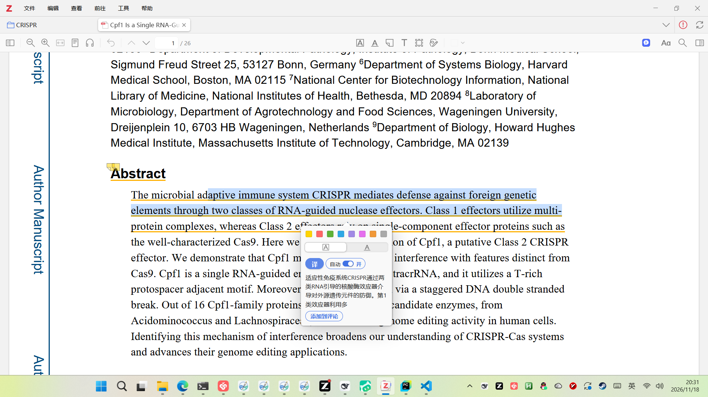

# dsh-in-zotero

把 [DeepSeek Harness（dsh）](https://github.com/deepseek-ai/deepseek-harness) 装进 [Zotero](https://www.zotero.org/)：在 Zotero 里直接使用 dsh 的原生会话界面、按文献绑定的阅读助手、划词流式翻译，以及「AI 重新获取元数据」。所有文库改动都通过 Zotero 自己的接口完成，绝不直接读写 `zotero.sqlite`。

[](https://github.com/Masterchiefm/dsh-in-zotero/releases/latest)
[](https://github.com/Masterchiefm/dsh-in-zotero/actions/workflows/release.yml)

## 功能

| 功能 | 入口 | 行为 |
| --- | --- | --- |
| **DSH 悬浮对话窗** | 文献列表工具栏（「新建条目 / 通过标识符添加条目 / …」按钮组的最后） | 点击弹出**悬浮窗**形态的 dsh 原生对话界面：窗口可拖动/缩放/收起，窄宽度下 dsh 的会话列表自动折叠（页内抽屉可展开）；点「标签页」一键切换为完整 Zotero 标签页（会话不中断、页面不重载），标签页里可一键切回。每次打开都新建并绑定一个 dsh 会话；dsh 只在首次点击时整页加载一次，之后常驻（sidecar 与页面都保活，重复点击秒开、无 loading 闪屏） |
| **阅读器助手** | PDF 阅读页工具栏（「外观」按钮左边） | 同一个会话界面，但**每篇文献绑定一个会话**：再次点击回到该文献绑定的会话；在这里新建会话（顶部按钮或 dsh 自带新建）会解绑旧会话并改绑新会话 |
| **划词翻译「译」** | 阅读器划词弹窗 | 胶囊形「译」按钮，点击流式翻译；旁边的「自动」开关可让划选后立即翻译（dsh 已在后台运行时生效）。可开启**深度思考模式**（思考内容实时流式显示，结束后自动折叠成一行，可随时展开回看）；译文结束后可一键**「添加到评论」**——在 PDF 上给所选文字落下划线批注、译文写进批注评论 |
| **翻译模型可选** | Zotero 设置 → dsh-in-zotero → 划词翻译 | 默认继承 dsh 当前使用的模型；也可从 dsh 已注册的全部模型中手动指定（点「刷新列表」加载） |
| **AI 重新获取元数据** | 文献列表右键菜单 | **每条文献一个独立的新会话**（任务历史互不污染），任务消息自带分步操作手册：首选 `zotero_identify` 一步识别权威元数据（读附件首页 → 提取 DOI/arXiv → 联网解析 → 标题比对打分），核对后经 `zotero_update` 写回全部字段（含 shortTitle / abstractNote 维护、条目类型更正），最后按固定格式汇报改动清单 |
| **文库整理** | 任意 dsh 会话（不只助手） | dsh 获得 20 个 `zotero_*` 工具：检索、读全文（真实路径）、改字段/作者/标签、改条目类型、归类移库、建分类、加附件、写笔记、回收站、联网元数据检索、阅读器检索/定位/标注…… |
| **自动更新** | — | 每周自动检查 GitHub Release，发现新版本自动下载安装（GitHub 直连失败时自动走 CDN 镜像）；也可在设置里关闭，手动从 Releases 页下载 |
| **自定义 dsh 来源** | Zotero 设置 → dsh-in-zotero | 自动检测本机 dsh 桌面版（含注册表/PATH，检测不到可手动指定安装目录）；或 npm 内置运行时（自动下载 @deepseek-ai/dsh，开箱即用）；或连接已在运行的 dsh 实例（粘贴带 `?token=` 的完整 URL） |

## 截图

<!-- 截图占位：把截图放进 screenshots/ 目录即可显示。



-->

（截图待补充：悬浮对话窗 / 阅读器助手 / 划词翻译弹窗 / AI 元数据重取报告）

## 下载安装

1. 到 [**Releases**](https://github.com/Masterchiefm/dsh-in-zotero/releases/latest) 下载最新的 `dsh-in-zotero-x.y.z.xpi`
   （国内直连 GitHub 慢时，可用任意 GitHub 加速镜像前缀拼接下载地址）
2. 打开 Zotero → 工具 → 插件 → 右上角齿轮 → **Install Plugin From File…** → 选中下载的 `.xpi`
3. 重启 Zotero

**运行要求**：

- Zotero 7 及以上（在 Zotero 10 上开发测试）
- dsh 桌面版（推荐，自动检测）**或** Node.js ≥ 24.9（无桌面版时用内置运行时自动 npm 安装）
- Zotero 设置 → 高级 → **允许本机其他应用与 Zotero 通信**（默认开启；dsh 的工具回调依赖它）
- 已在 dsh 中配置过模型（`~/.dsh/.credentials.yaml`），否则翻译与 AI 功能无法工作（会话窗口本身可用）

## 快速上手

1. **配置 dsh**：装了 [dsh 桌面版](https://github.com/deepseek-ai/deepseek-harness) 的话插件会自动检测（检测不到时在设置里手动指定安装目录）；没有桌面版就走内置运行时（首次使用自动 `npm install`，需 Node ≥ 24.9）
2. **开始对话**：点文献列表工具栏最右侧的 DSH 唤醒按钮，弹出 dsh 对话窗——像在 dsh 桌面版里一样对话，但它能直接看到你的 Zotero 文库
3. **阅读时提问**：打开一篇 PDF，工具栏「外观」左边会出现唤醒按钮——这里每篇文献有自己的专属会话
4. **划词翻译**：在 PDF 里划选文字，弹窗里点「译」（或打开「自动」开关直接流式翻译）

## 更新

- **自动**：插件每周检查一次 GitHub Release，发现新版本自动下载安装（GitHub 直连失败时自动尝试 CDN 镜像），重启 Zotero 生效。设置里可关闭。
- **手动**：从 [Releases](https://github.com/Masterchiefm/dsh-in-zotero/releases) 下载新 `.xpi` 重复安装步骤即可（设置会保留）。

---

# 开发者文档

## 架构原理

```
┌───────────────────────────── Zotero (主进程) ─────────────────────────────┐
│  dsh-in-zotero 插件                                                        │
│   • 工具栏/阅读器唤醒按钮、右键菜单、划词「译」、会话窗口标签页                  │
│   • /dsh-bridge/* 本地端点（端口 23119，令牌校验）                            │
│       —— 所有读写都用 Zotero 官方 API（saveTx / Attachments.* / …）           │
│   • 子进程管理：spawn `dsh --profile dsh-in-zotero --no-open --port 0`        │
│   • 会话窗口：REMOTE <browser> 内嵌 dsh Web UI（Zotero 拒绝在进程内           │
│     browser 加载 http），Zotero↔页面 通过同源通道通信：                        │
│       导航 = URL 键 #session=<id>；观测 = 页面每 2s POST ui.report            │
└──────────────┬──────────────────────────────────────────────────────────┘
               │ HTTP 127.0.0.1（x-dsh-in-zotero-token）
┌──────────────▼──────────────────── dsh sidecar (Node) ───────────────────┐
│  dsh web（Web UI + JSON-RPC 网关）                                          │
│   • dsh-in-zotero-bridge 插件（host 半区）                                   │
│      - zotero_* agent 工具（20 个）→ 回调 Zotero /dsh-bridge/*              │
│      - /api/zotero/rpc：会话创建/解析/列表、AI 元数据任务、ui.state            │
│      - /api/zotero/translate：NDJSON 流式翻译（用 dsh 自己的模型路由）          │
│      - /api/zotero/models：已注册模型列表（翻译模型选择）                       │
│      - Zotero 工作区会话的系统提示词引导（zoteroGuidance）                     │
│   • client 半区：hash→uiWorkspace.openSession 会话导航 + ui.report 上报      │
└──────────────────────────────────────────────────────────────────────────┘
```

- **会话/凭据共享**：默认使用用户真实的 `~/.dsh`（会话、API Key、模型选择与桌面 dsh 共享），但使用独立 profile `dsh-in-zotero`，不会与正在运行的 dsh 桌面版冲突。可用 `extensions.zotero.dsh-in-zotero.dshHome` 改成独立目录。
- **不阻塞数据库**：dsh 侧的一切写操作都通过 `/dsh-bridge/*` 回到 Zotero 执行；插件从不打开 `zotero.sqlite`。
- **真实路径阅读**：`zotero_read` 返回附件的磁盘真实路径与全文文本（优先 Zotero 自己的全文缓存 `.zotero-ft-cache`，其次 Zotero 的 PDF 文本提取）。
- **会话语义**：文献列表唤醒按钮每次打开都新建会话（可下拉切换/浏览全部）；阅读器按钮为每篇文献绑定一个会话——再次点击回到绑定会话，在 dsh 里新建会话会自动改绑到新会话。

## 从源码构建

```bash
npm run install-runtime   # 把 @deepseek-ai/dsh 装进 .dsh-runtime/（也可让插件首次运行时自动安装）
npm run build             # 产出 dsh-in-zotero.xpi（零 npm 依赖，纯 Node 脚本）
```

发布流程：打 `v*` 标签推送即可，[GitHub Action](.github/workflows/release.yml) 会自动语法检查、构建 `.xpi`、发布 Release，并把新版本写进根目录的 `update.json`（Zotero 原生插件更新器读取的清单）。

## 测试

```bash
npm run check            # 全部 JS 语法检查
npm run test:sidecar     # 离线集成：sidecar 启动 / RPC / 插件路由 / 工具直调（含真实 DOI 联网检索）
node tests/sidecar-live.test.mjs   # 真模型实测：创建会话 + 元数据任务 + 翻译流
node tests/zotero-live.test.mjs    # 对运行中的 Zotero 实测 /dsh-bridge/* 各端点（20 项，读写测试条目后清理）
```

`debug.*` 桥端点（token 守卫，随插件发行）可在不碰 GUI 的前提下驱动/观察实机：`debug.open / debug.state / debug.openreader / debug.reader / debug.refetch / debug.update / debug.prefs / debug.cleanup` 等，见 `zotero-plugin/content/scripts/bridge.js` 的 `OPS` 表。

## 偏好设置（Zotero 设置 → dsh-in-zotero；也可 about:config，`extensions.zotero.dsh-in-zotero.*`）

| 键 | 默认 | 说明 |
| --- | --- | --- |
| `dshMode` | `auto` | dsh 来源：`auto`（自动检测）/ `bundled`（内置运行时）/ `attach`（连接已运行实例）；旧值 `desktop`/`custom` 归一化为 `auto` |
| `dshCustomDir` | 空 | auto 模式优先使用的本机 dsh 包目录（须含 `lib/bin.js`） |
| `desktopDir` | 空 | dsh 桌面版安装目录（含 `DeepSeek Harness.exe`）——自动检测不到时手动指定 |
| `attachUrl` | 空 | attach 模式目标实例的完整 URL（含 `?token=…`） |
| `nodePath` | 自动探测 | node.exe 绝对路径 |
| `dshHome` | `%USERPROFILE%\.dsh` | dsh 主目录（会话/凭据共享；设为其他目录即完全隔离） |
| `profileName` | `dsh-in-zotero` | sidecar 使用的 dsh profile |
| `port` | `0`（自动分配） | dsh web 端口 |
| `dshPackageVersion` | `0.2.2-rc.1` | 自动安装的 @deepseek-ai/dsh 版本 |
| `npmRegistry` | npm 默认 | 安装运行时用的 registry |
| `translateEnabled` | `true` | 划词弹窗是否显示「译」 |
| `translateAuto` | `false` | 划选后自动翻译（dsh 已在运行时） |
| `translateThinking` | `false` | 翻译时是否开启思考模式（思考内容流式显示、结束自动折叠） |
| `translateModel` | 空（继承） | 翻译模型，`provider/model`；空 = 跟随 dsh 当前选择 |
| `autoUpdate` | `true` | 每周自动检查并安装更新 |

## 仓库布局

```
.github/workflows/  → Release CI（tag → 构建 → 发布 → 维护 update.json）
zotero-plugin/      → 打包为 .xpi 的 Zotero 插件（bootstrap + chrome 脚本）
dsh-plugin/         → 装进 sidecar profile 的 dsh 插件（host: 工具/路由/提示词；client: 页面桥）
scripts/            → 构建 / 语法检查 / 运行时安装（纯 Node，零依赖）
tests/              → mock Zotero 桥 + 离线/实机测试
AGENTS.md           → 面向 AI 代理/贡献者的实机开发指南（踩坑全集）
update.json         → Zotero 原生插件更新清单（CI 维护）
```

## 致谢

- 提示词与工具形态大量参考 [dsh-zot-library](https://github.com/GenePad/dsh-zot-library)（dsh 的 Zotero 直连文献库插件——本项目把写路径换成 Zotero 官方接口并反向嵌入进 Zotero）。
- [zotero-chinese](https://zotero-chinese.com/plugin-dev-guide/) 的插件开发指南。
